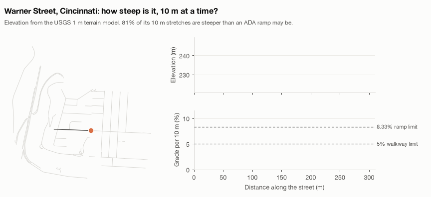
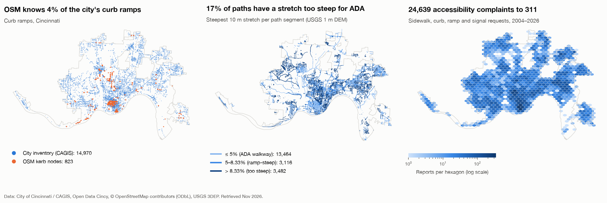
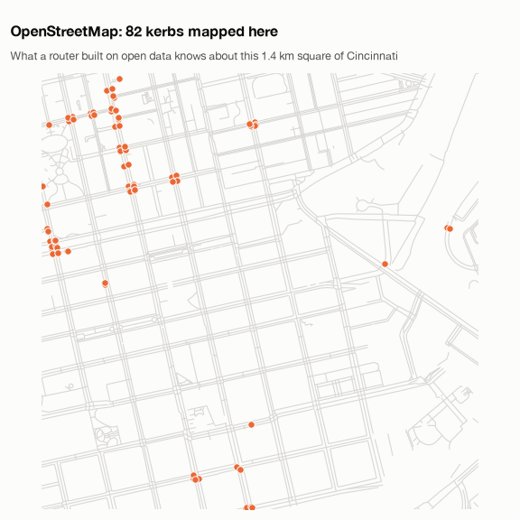
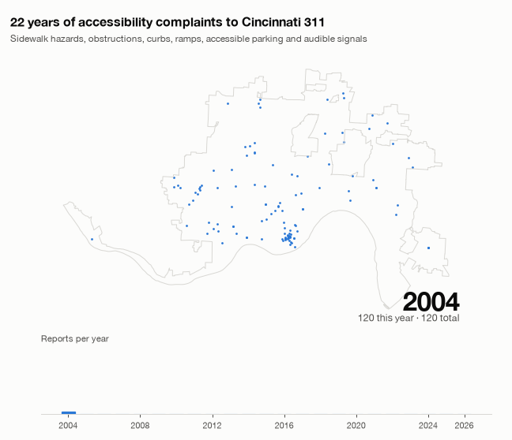

<div align="center">

# Ohio Access Atlas

**A research project collecting wheelchair-access information for Cincinnati and Oxford, Ohio**

[**Quick start**](#quick-start) · [**A look at the data**](#a-look-at-the-data) · [**What data do we have?**](#what-data-do-we-have) · [**How the data is organized**](#how-the-data-is-organized) · [**What did we calculate?**](#what-did-we-calculate-and-why) · [**First findings**](#first-findings) · [**Project layout**](#project-layout) · [**Sources**](SOURCES.md)




<sub>A dot moves along Warner Street. The project uses a USGS elevation model—a grid that records how high the land is—to estimate how steep the street is about every 10 metres. The estimate describes the land, not a direct measurement of the sidewalk.</sub>

| **355,568** recorded facts, including two Oxford slope methods | **12** data sources set up in the project | **2** Ohio cities | **24,639** Cincinnati 311 requests | **14,970** Cincinnati curb ramps | **23,934** walking-path sections with local slope estimates |
|:-:|:-:|:-:|:-:|:-:|:-:|

</div>

## Why

- **Open maps often leave out accessibility details.** In Cincinnati, only **99 of 6,235 named places (1.6%) have any label about wheelchair access** in OpenStreetMap. A map label is a short note added by a contributor, such as `wheelchair=yes`. Also, **4.1% of the ramps listed by CAGIS have a nearby OpenStreetMap point marking a curb edge** within 10 metres. This is a nearby-point comparison, not proof that only 4.1% of ramps appear on the map. The [report code](src/atlas/report.py) calculates these numbers from [OpenStreetMap](https://overpass-api.de/api/interpreter) and [CAGIS curb-ramp data](https://cagisonline.hamilton-co.org/arcgis/rest/services/DTE/DOTE_Versioned/FeatureServer/0). Run `make report` to regenerate the report.
- **No single source is enough.** [CAGIS](https://cagisonline.hamilton-co.org/arcgis/rest/services/DTE/DOTE_Versioned/FeatureServer/0) gives ramp locations, but not whether each ramp works well today; [Cincinnati 311](https://data.cincinnati-oh.gov/resource/gcej-gmiw.json) records reported problems, but only where and when people report them; [OpenStreetMap](https://overpass-api.de/api/interpreter) maps paths and places, but often lacks accessibility details. We compare sources because each tells us a different part of the picture.
- **We keep track of where facts came from.** Each record notes its source and when it was collected. The original downloaded responses are saved so results can be checked and rebuilt.
- **It is a research data layer for a planned assistant.** The atlas is not yet a route planner or a working question-answering model. The research goal is to build an assistant that uses evidence and says "unknown" when information is missing.

## A look at the data



<sub><b>Left:</b> the city's curb-ramp inventory (blue) against the kerbs mapped in OpenStreetMap (orange). <b>Middle:</b> the steepest 10 m stretch of every path segment. <b>Right:</b> where residents report sidewalk, curb, ramp and signal problems.</sub>

<table>
<tr>
<td width="50%"></td>
<td width="50%"></td>
</tr>
<tr>
<td><sub><b>What a router knows vs. what exists.</b> In this square OpenStreetMap has a handful of kerbs; the city's inventory has 747 curb ramps.</sub></td>
<td><sub><b>22 years of complaints.</b> 24,639 sidewalk, curb, ramp, parking and signal requests. Volume quadruples from 2025.</sub></td>
</tr>
</table>

## What data do we have?

The table lists the data currently collected. A **recorded fact** is one detail about one mapped thing—for example, a place has a wheelchair-access tag, or a path has a surface type. The same place or path can have several recorded facts.

| What the data describes | Where it came from | Cincinnati | Oxford |
|---|---|--:|--:|
| Places, walking paths, crossings, kerbs, steps, and other map details | [OpenStreetMap, collected through Overpass](https://overpass-api.de/api/interpreter) | 27,796 facts | 3,894 facts |
| Estimated steepness of walking paths, using USGS elevation files | [USGS 3D Elevation Program (3DEP)](https://tnmaccess.nationalmap.gov/api/v1/products) | 40,124 facts for 20,062 path sections | 7,744 facts for 3,872 path sections |
| A second estimate of Oxford path steepness, from the USGS online elevation map | [USGS elevation service](https://elevation.nationalmap.gov/arcgis/rest/services/3DEPElevation/ImageServer) | – | 7,744 facts for the same 3,872 sections |
| Curb-ramp locations | [Cincinnati/Hamilton County curb-ramp map](https://cagisonline.hamilton-co.org/arcgis/rest/services/DTE/DOTE_Versioned/FeatureServer/0) | 14,970 ramps | – |
| Sidewalk and walkway areas | [Cincinnati/Hamilton County sidewalk map](https://cagisonline.hamilton-co.org/arcgis/rest/services/DTE/DOTE_Versioned/FeatureServer/0) | 220,792 areas | – |
| Public stairways | [Cincinnati public-steps map](https://cagisonline.hamilton-co.org/arcgis/rest/services/Cincinnati/PS_Maintenance/MapServer/1) | 160 stairways | – |
| Traffic signals | [Cincinnati traffic-signal map](https://cagisonline.hamilton-co.org/arcgis/rest/services/DTE/DOTE_Traffic_Engineering/FeatureServer/8) | 5,324 signals | – |
| Accessibility-related requests to the city's 311 service | [Cincinnati 311 data, dataset `gcej-gmiw`](https://data.cincinnati-oh.gov/resource/gcej-gmiw.json) | 24,639 requests | – |
| Bus stops and whether the bus feed says boarding is wheelchair-accessible | [Cincinnati Metro bus data](https://files.mobilitydatabase.org/mdb-307/latest.zip) | 2,320 stops | – |
| Bus stops from an older Butler County transit feed | [Butler County Regional Transit Authority bus data](https://files.mobilitydatabase.org/mdb-240/latest.zip) | – | 61 stops |

The numbers count different things. For example, 14,970 is the number of mapped Cincinnati ramps, while 27,796 is the number of accessibility details extracted from OpenStreetMap. Slope has two measurements per path section. Altogether, the saved files contain **355,568 recorded facts**, including both Oxford slope estimates. This is not a count of unique streets or places.

The Cincinnati neighborhood analysis also uses U.S. Census estimates of population, race, disability, and household income. It gets these through [Esri's Census race data](https://p3eplmys2rvchkjx.svcs.arcgis.com/P3ePLMYs2RVChkJx/arcgis/rest/services/ACS_Race_and_Hispanic_Origin_View_Boundaries/FeatureServer/2), [income data](https://p3eplmys2rvchkjx.svcs.arcgis.com/P3ePLMYs2RVChkJx/arcgis/rest/services/ACS_Median_Household_Income_View_Boundaries/FeatureServer/2), and [disability data](https://p3eplmys2rvchkjx.svcs.arcgis.com/P3ePLMYs2RVChkJx/arcgis/rest/services/ACS_Disability_Status_View_Boundaries/FeatureServer/2). It also uses [OpenStreetMap road data](https://overpass-api.de/api/interpreter) to measure road length in each census area. These are analysis inputs, not included in the 355,568 facts above.

**County coverage:** Cincinnati is in Hamilton County. Oxford is in Butler County, so the Hamilton County CAGIS sidewalk and ramp data in this project does **not** cover Oxford. Oxford currently has OpenStreetMap and elevation data, plus an old BCRTA bus feed; we still need local sidewalk and ramp information for Oxford.

Reddit has an optional data-collection tool, but no Reddit posts are in the saved data. Google data is not used.

### Possible future sources

- [Google Places](https://developers.google.com/maps/documentation/places/web-service)
- [Reddit](https://www.reddit.com/dev/api/)
- [Oxford Area Trails](https://www.oxfordareatrails.org/visit-the-trails)
- [Great Parks of Hamilton County](https://www.greatparks.org/)
- [Ohio Department of Natural Resources](https://ohiodnr.gov/)
- [City of Oxford](https://www.cityofoxford.org/)
- [Miami University](https://www.miamioh.edu/)
- [Butler County GIS](https://www.butlercountyauditor.org/)

See [`SOURCES.md`](SOURCES.md) for all current and possible data sources.

### Where to find the data

Processed files are saved under [`data/processed/`](data/processed/) in `cincinnati/` and `oxford/`. Each source generally has:

- `*.entities.parquet`: the original map features or records.
- `*.obs.parquet`: the facts taken from those features and put into the shared format.
- `report.md`: a summary of how much information is available and how sources compare.
- Cincinnati also has `equity_tracts.parquet`, `equity_requests.parquet`, and `equity_report.md`.

The elevation grid files are under [`data/dem/`](data/dem/); their download lists are [`cincinnati_tiles.csv`](data/dem/cincinnati_tiles.csv) and [`oxford_tiles.csv`](data/dem/oxford_tiles.csv). Original web responses are saved under `data/raw/`.

**The downloaded and processed data stays on this computer and is not included in Git** (except the small elevation-file lists). The collection commands create it; downloading everything takes time and several gigabytes. See [`config/sources.yaml`](config/sources.yaml) for the sources and collection settings, and [`SOURCES.md`](SOURCES.md) for source links and notes.

## Quick start

```bash
make setup     # venv + install
make data      # fetch every no-credential source for both cities (~30 min, cached after)
make dem       # download about 3.4 GB of elevation grids and estimate path steepness
make report    # summarize what data is present and how sources compare
make equity    # analyze Cincinnati requests and ramp supply by census area
make figure    # this README's figure and animations
make test

.venv/bin/atlas sources                              # list configured sources
.venv/bin/atlas fetch cincy_311 --region cincinnati  # refresh one source
```

## How the data is organized

The project puts details from different sources into a shared table. **Each row records one detail about one place, path, crossing, or bus stop.**

| In the file | What it means |
|---|---|
| An ID such as `osm:way/706070710` | Which mapped thing the row is about |
| Type, such as `path_segment` or `transit_stop` | What kind of thing it is |
| `attribute` and `value`, such as `surface` = `asphalt` | What detail the source recorded |
| `signal` | A simple label: seems helpful, may be difficult, likely a barrier, or not known |
| Source and source link | Where the detail came from |
| Dates | When the source recorded it, or when we downloaded it |
| Location and region | Where the mapped thing is |

For example, one row might say “this path is marked as asphalt” and another row might say “this bus stop has boarding code 1.” These are source-recorded details, not necessarily independently checked facts.

The `signal` column is a **rough guide, not a final decision about accessibility**. The code in [`signals.py`](src/atlas/signals.py) compares some recorded details with ADA guidelines—for example, how steep or wide a path is. It also labels some surface types, steps, curb edges, and wheelchair-access details. If information is missing or unclear, it says “unknown.” A mapped ramp may still be damaged, and slope from an elevation model (a grid of land heights) is not the same as measuring the actual sidewalk.

The original mapped feature is kept separately from these detail rows in a file that can store map shapes and locations.

## What did we calculate, and why?

1. **Path steepness.** The code follows a mapped walking path and looks up land height from a USGS elevation grid about every 10 metres. It compares the height change with the distance to estimate steepness, then saves the steepest stretch and the overall change along the path. This can flag places to investigate. It is only an estimate of the land—not a direct sidewalk measurement.
2. **Rough accessibility labels.** The code turns some source details into four simple labels: “seems helpful,” “may be difficult,” “likely a barrier,” or “not known.” This makes records easier to summarize, but does not certify that a place meets accessibility standards or will work for a specific person.
3. **Missing details and source comparison.** Reports count how often maps include details such as wheelchair access, path material, width, or steepness. They also check whether a city-listed ramp has a mapped kerb or crossing within 5, 10, or 20 metres. This helps show where data is missing or sources disagree. Nearby points are not guaranteed to be the same ramp.
4. **Cincinnati neighborhood comparison.** The analysis compares 311 reports, ramps, sidewalk area, population, income, race, and disability estimates across census areas. It estimates reports per resident, ramps per kilometre of road, and how long requests take to close. It also checks whether repeat complaints or nearby areas might affect the pattern. These results show relationships in the collected data; they do not prove that one thing caused another.

The project does **not** yet create complete wheelchair routes, check every label in person, or train the planned AI assistant. Those are future research goals.

## First findings

These are early results from the data we collected. For the neighborhood comparisons, the ranges in parentheses show how uncertain the estimates are (95% confidence intervals).

| What we measured | What we found |
|---|---|
| City curb ramps with a mapped OSM kerb within 10 metres | **4.1%** (3.7% within 5 m; 4.7% within 20 m) |
| Paths with a stretch steeper than 8.33%, the ADA guideline for ramps | **17.4%** in Cincinnati; **5.3%** in Oxford |
| Oxford elevation-grid and OpenStreetMap steepness estimates, on 396 paths | They fell on the same side of the 5% mark **89%** of the time |
| Hazardous-sidewalk reports for each resident, comparing areas with $10,000 higher median income | About **10% more reports** (estimated range: 5% to 15% more) |
| Same report rate, comparing areas with 10 percentage points more Black residents | About **8% fewer reports** (estimated range: 2% to 13% fewer) |
| How quickly 311 requests were closed, compared across neighborhood income, race, disability, and steepness | No clear difference in this analysis |
| Curb ramps per kilometre of road, for each 1% increase in average path steepness | About **6% fewer ramps** (estimated range: 4% to 9% fewer) |

An additional check looked for repeat reports about the same still-open problem. It found **954 repeat reports**. After adjusting the report counts using this check, higher-income areas still had about **14% more hazardous-sidewalk reports per resident** (estimated range: 9% to 20% more). So this repeat-report check did not explain away the difference.

These are early results from **108 census areas** (small areas used to report population statistics) and **18,007 repair requests**. Nearby areas also tended to have similar unexplained patterns, so a more detailed geographic analysis is a useful next step. The results show relationships, not proof of cause, and 311 reports may not capture every problem. See [`docs/research_plan.md`](docs/research_plan.md) for research limitations.

## Project layout

```
config/
  regions.yaml          the two city boundaries used for collection
  sources.yaml          where each data source comes from and what we collect
src/atlas/
  core.py               shared code for downloads, boundaries, and saving data
  signals.py            simple rules for the four accessibility labels
  dem.py                finds, downloads, and reads USGS elevation grid files
  connectors/           code that downloads each kind of source
  analysis/equity.py    Cincinnati 311 and curb-ramp neighborhood comparisons
  analysis/robustness.py  checks repeat reports and geographic patterns
  report.py             makes data coverage and source-comparison reports
  cli.py                commands for collecting data and making reports
scripts/
  make_readme_figure.py   static overview map
  make_readme_gifs.py     the three animations
docs/
  research_plan.md      questions, research steps, and limitations
  data_landscape.md     possible sources and what data they may provide
  literature/           notes about related research
  figures/
tests/                  tests for the simple accessibility-label rules
data/                   downloaded elevation files and collected city data
SOURCES.md              source links and whether data has been collected
```
